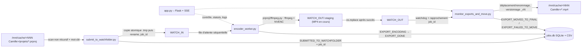

# export_prproj_encoder – Documentation

Ce dossier documente l'application Flask (`app.py`) et les modules qui l'accompagnent : soumission
des projets Premiere `.prproj`, encodage par **prproj2ffmpeg** (ffmpeg, NVENC avec repli logiciel)
et déplacement des exports terminés vers leur dossier projet.

C'est le portage Linux de l'application Adobe Media Encoder (`F:\export_media_encoder`), qui reste
inchangée et utilisable en parallèle (jamais simultanément sur les mêmes projets).

## Documentation par module

- [app.md](./app.md) – interface Flask, authentification, SSE, orchestration des threads.
- [submit_to_watchfolder.md](./submit_to_watchfolder.md) – scan, nom final attendu, copie atomique, journaux.
- [encoder_worker.md](./encoder_worker.md) – file d'attente, `prproj2ffmpeg` (ffmpeg/NVENC), staging, reprise, abandon.
- [monitor_exports_and_move.md](./monitor_exports_and_move.md) – surveillance de la sortie, rapprochement, déplacement, quarantaine.
- [folder_structure.md](./folder_structure.md) – arborescence des projets et des dossiers de travail.
- [perf_export.md](./perf_export.md) – diagnostic et optimisation d'un export lent (overlay masqué 252 %, fenêtre visible, mesures A/B).
- [audit_linux_port.md](./audit_linux_port.md) – audit du code de la version Linux (document historique, établi avant la migration `.prproj`/ffmpeg).

## Aperçu du workflow

## Dossiers et fichiers clés

- `app.py` : UI web (authentification par session, CSRF, CSP), console de logs SSE, statuts
  Soumission / Moniteur / Encodeur. Démarre les deux threads de fond et lance la soumission en
  sous-processus.
- `submit_to_watchfolder.py` : scan de `BASE_SCAN_FOLDER`, filtrage `FOLDER_KEYWORD`, priorité à la
  variante `_assist` d'un projet, nom final attendu d'après le nom du fichier `.prproj` nettoyé,
  copie atomique vérifiée vers `WATCH_IN`, journalisation SQLite + CSV + journal texte.
- `encoder_worker.py` : consomme `WATCH_IN`, encode via `prproj2ffmpeg.py`, publie le MP4 dans
  `WATCH_OUT`, archive le projet dans `WATCH_IN/Source/<horodatage>/`.
- `monitor_exports_and_move.py` : surveille `WATCH_OUT` (watchdog + rescan périodique), déplace et
  renomme les exports, versionne les collisions, met en quarantaine les fichiers non rapprochés.
- `prproj_engine.py` : pilotage du script d'encodage (construction de la commande, suivi de la
  sortie en flux, progression, résumés français pour l'UI, abandon par groupe de process).
- `tools/prproj-unpacker/` : `prproj2ffmpeg.py` vendorisé (voir `PROVENANCE.md`) + `unpack.pl`.
- `tools/benchmark_export.py` : benchmark reproductible (muxer `null`, `-benchmark`) ; voir
  [perf_export.md](./perf_export.md).
- `config.py` / `db_helper.py` / `filename_utils.py` : configuration, persistance, noms de fichiers.
- `logs_watchfolder/` :
  - `jobs.db` (base pivot des statuts d'export) ;
  - `submission_log.csv` (registre structuré, une ligne par soumission) ;
  - `submission_log.txt` (journal texte lisible, archivé à chaque soumission) ;
  - `monitor_log.txt` / `encoder_log.txt` (journaux des tâches de fond, rotation à 5 Mo) ;
  - `exports/<job>.log` (journal complet de chaque encodage : commande ffmpeg + sortie brute).
- `WATCH_IN/` (`Source/`), `WATCH_OUT/` (`.staging/`, `quarantine/`).

## Configuration par variables d'environnement (.env)

Toute la configuration passe par `config.py` et le fichier `.env` (`.env.example` documente chaque
variable). Points d'attention :

- `BASE_SCAN_FOLDER` + `FOLDER_KEYWORD` + `PROJECTS_SUBFOLDER` + `INPUT_EXTENSIONS` décrivent ce qui
  est scanné (`/mnt/cache/*Camille*/projets/*.prproj` par défaut) ;
- `WATCH_FOLDER_INPUT` / `WATCH_FOLDER_OUTPUT` / `LOGS_DIRECTORY` sont locaux à l'application
  (ext4) : la base, les journaux et les fichiers temporaires ne sont jamais écrits sur le montage
  NTFS ;
- `OUTPUT_FILENAME_FORMAT` accepte `{project_file_stem}` (nom du fichier `.prproj` nettoyé : préfixe
  numérique, « copy N » et suffixe `_assist` retirés, suffixes de version `_2` conservés — défaut) ;
- les réglages d'encodage (`PRPROJ2FFMPEG_ENCODER`, `PRPROJ2FFMPEG_BITRATE`) pilotent le script
  vendorisé : `auto` = `h264_nvenc` si réellement utilisable (préflight, repli `libx264`), CBR
  10 Mbps + audio AAC 320 kbps (toutes les pistes mixées) ;
- `PRPROJ2FFMPEG_EXTRA_BASES` ajoute des racines de résolution des médias (en plus des bases
  automatiques : racine du projet d'origine, son parent, `BASE_SCAN_FOLDER`).

## Statuts

| Statut | Écrit par | Signification |
|---|---|---|
| `SUBMITTED_TO_WATCHFOLDER` | soumission | projet copié dans `WATCH_IN`, en attente d'encodage |
| `EXPORT_ENCODING` | encodeur | encodage `prproj2ffmpeg` en cours |
| `EXPORT_DONE` | encodeur | MP4 publié dans `WATCH_OUT`, en attente de déplacement |
| `EXPORT_FAILED` | encodeur | encodage en échec (journal du job conservé) |
| `EXPORT_ABORTED` | encodeur | abandon demandé par l'utilisateur (« Arrêter ») |
| `EXPORT_SUPERSEDED` | soumission | version normale remplacée par la variante `_assist` avant encodage (job archivé sans MP4) |
| `EXPORT_MOVED_TO_FINAL` | moniteur | MP4 déplacé/renommé dans le dossier projet |
| `EXPORT_FAILED_TO_MOVE` | moniteur | déplacement impossible après tous les réessais |
| `EXPORT_DONE_WITH_WARNINGS` | (historique) | n'est plus émis ; reste accepté pour les anciennes lignes |
